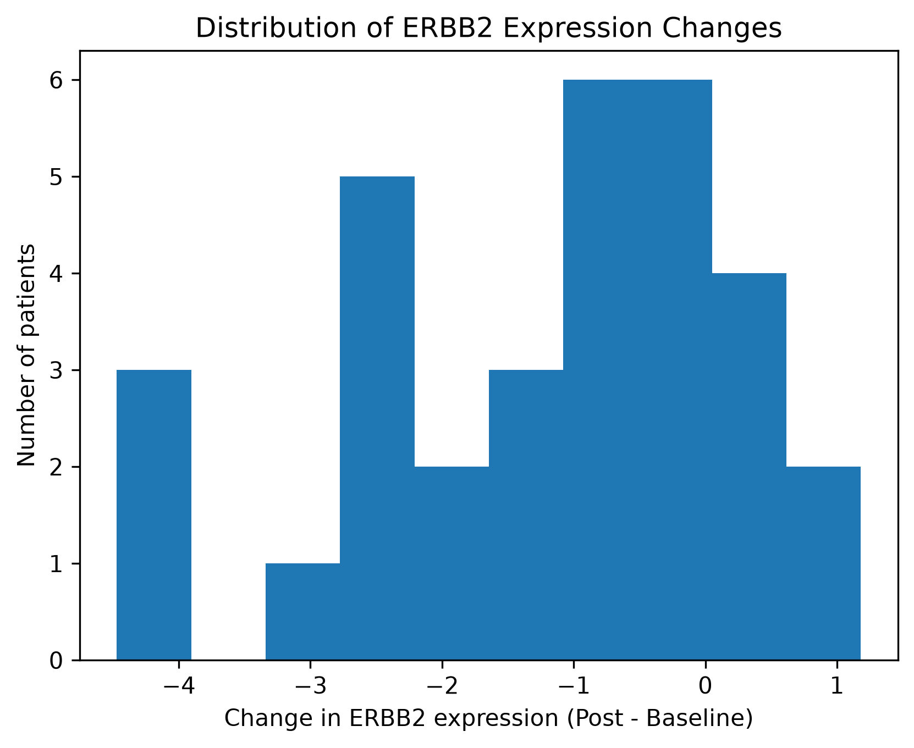
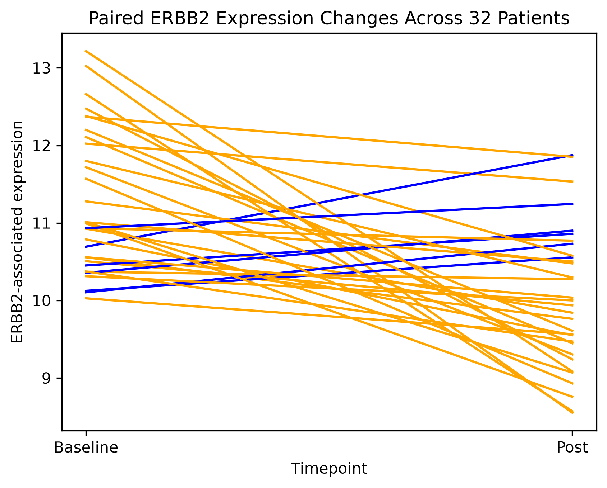

# ERBB2-Associated Gene Expression Analysis in HER2-Positive Breast Cancer

## Project Overview

This project explores changes in ERBB2-associated gene expression between baseline and post-treatment samples from patients with HER2-positive breast cancer.

Using publicly available microarray data from the Gene Expression Omnibus (GEO), I analyzed patient-level expression changes and applied statistical methods to evaluate whether the average paired change was significantly different from zero.

Through this analysis, I explored patient-level variability in gene expression changes while gaining hands-on experience in biological data processing, statistical analysis, and data visualization using Python.

## Dataset
- **Source:** NCBI Gene Expression Omnibus (GEO)
- **GEO Series ID:** GSE245132
- **Platform:** GPL23159
- **Data type:** Processed microarray gene expression data
- **Samples:** 64 samples from 32 patients, with paired baseline and post-treatment measurements
- **Expression matrix:** 21,448 features across 64 samples

The analysis focuses on the microarray feature `TC1700012249.hg.1`, which is associated with ERBB2-related annotations.

## Methods

The analysis was performed using Python, pandas, NumPy, SciPy, and Matplotlib.

### 1. Data Exploration and Preprocessing

- Inspected the GEO expression matrix and sample metadata.
- Identified ERBB2-associated microarray features using platform annotations.
- Matched expression measurements to patient IDs and sampling timepoints.
- Organized baseline and post-treatment measurements into paired patient-level data.

### 2. Exploratory Data Analysis

- Calculated expression changes for each patient (Post − Baseline).
- Summarized the mean, median, and variability of paired changes.
- Visualized the distribution of expression changes and individual patient trajectories.

### 3. Statistical Analysis

- Performed a two-sided paired t-test to evaluate whether the mean paired change differed from zero.
- Calculated a 95% confidence interval for the mean paired difference using the t-distribution.

### 4. AI-Assisted Statistical Analysis

I used GitHub Copilot Agent to help implement the 95% confidence interval calculation.

- Defined the statistical analysis goal and reviewed the AI-generated Python code.
- Independently validated the result using SciPy's `stats.t.interval()`.
- Confirmed that both methods produced the same confidence interval.
- Managed the changes in a separate Git branch (`agentic-stats`).

This experience helped me practice AI-assisted coding while emphasizing the importance of understanding and independently validating AI-generated code.

## Results

| Metric | Result |
|---|---|
| Paired patients | 32 |
| Mean expression change | −1.2077 |
| Median expression change | −0.80 |
| Patients with decreased expression | 26 (81.25%) |
| Patients with increased expression | 6 (18.75%) |
| Paired t-test | p < 0.001 |
| 95% confidence interval | [−1.7392, −0.6762] |

The average ERBB2-associated expression change was negative, and the paired t-test indicated a statistically significant difference between baseline and post-treatment measurements.

### Figure 1. Distribution of ERBB2 Expression Changes

However, individual patients showed different directions and magnitudes of change, highlighting variability within the analyzed group.

### Figure 2. Patient-Level ERBB2 Expression Changes

## Limitations

- The selected microarray feature is associated with ERBB2 and MIR4728 annotations. Its gene specificity requires further verification against the official platform annotation.
- Microarray measurements do not directly represent HER2 protein abundance or activity.
- The observed association does not establish that treatment caused the expression changes.
- Findings from 32 paired patients cannot automatically be generalized to the broader breast cancer population.

## Skills Demonstrated

- Biological data exploration and preprocessing with Python and pandas
- GEO microarray data interpretation
- Patient-level paired data analysis
- Exploratory data visualization
- Statistical hypothesis testing and confidence interval estimation
- Critical interpretation of biological results and analytical limitations

## Tools & Technologies

- **Programming Language:** Python
- **Data Analysis:** pandas, NumPy
- **Statistical Analysis:** SciPy
- **Data Visualization:** Matplotlib
- **Development Environment:** Jupyter Notebook
- **AI-Assisted Coding:** GitHub Copilot Agent
- **Version Control:** Git, GitHub

## Data Availability

The original dataset is publicly available through [NCBI GEO: GSE245132](https://www.ncbi.nlm.nih.gov/geo/query/acc.cgi?acc=GSE245132).

## How to Run

1. Clone this repository.
2. Download the GSE245132 series matrix file from NCBI GEO.
3. Create a `data/` folder in the repository root directory, alongside the `notebooks/` folder.
4. Decompress the downloaded file and save it as `GSE245132_series_matrix.txt` in the `data/` folder.
5. Open `notebooks/01_data_exploration.ipynb` in Jupyter Notebook.
6. Run the cells in order, using `notebooks/` as the working directory.

**Note:** The notebook uses the relative path `../data/GSE245132_series_matrix.txt`. If your working directory differs, adjust the path accordingly.